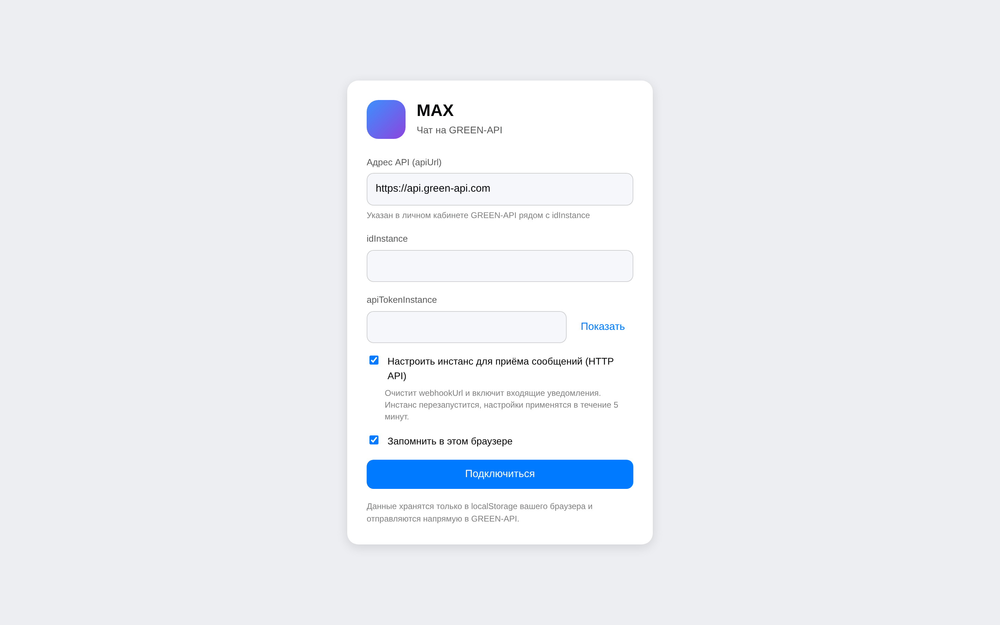
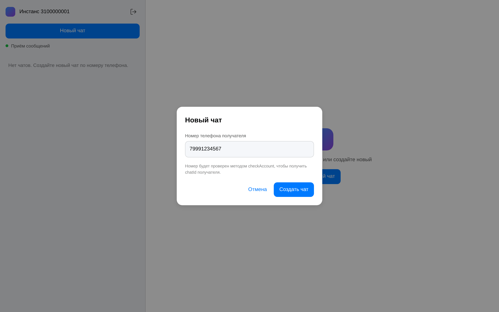
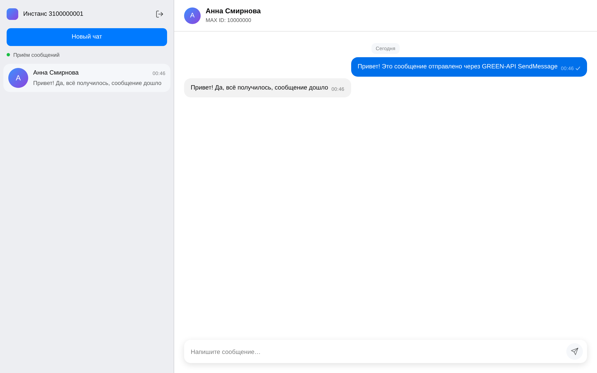
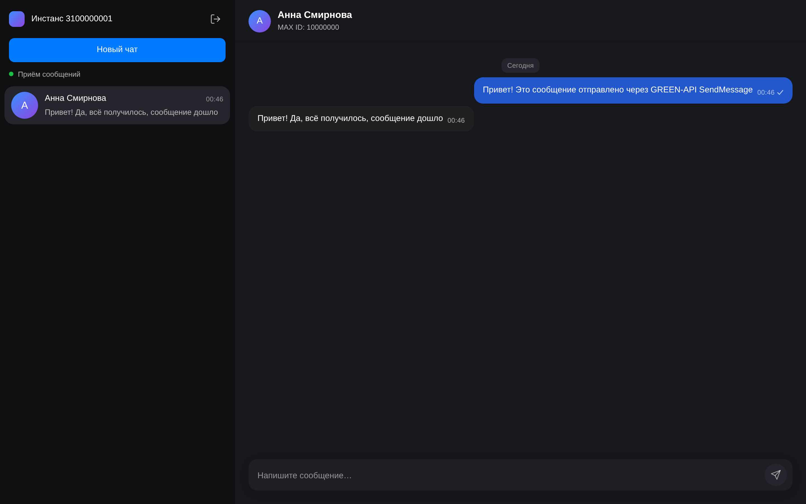

# MAX-чат на GREEN-API

Веб-клиент чата для мессенджера MAX на React (Vite + TypeScript). Пользователь входит
по `idInstance` и `apiTokenInstance`, создаёт чат по номеру телефона получателя,
отправляет текстовое сообщение методом `SendMessage` и видит ответ собеседника,
который забирается длинным опросом `ReceiveNotification` / `DeleteNotification` по
технологии HTTP API. Интерфейс повторяет раскладку и токены веб-клиента MAX.

## Соответствие требованиям

| Требование | Реализация |
| --- | --- |
| 1. UI для отправки и получения сообщений в MAX | Двухпанельный экран: [src/components/Sidebar.tsx](src/components/Sidebar.tsx), [src/components/ChatHeader.tsx](src/components/ChatHeader.tsx), [src/components/MessageList.tsx](src/components/MessageList.tsx), [src/components/MessageBubble.tsx](src/components/MessageBubble.tsx), [src/components/MessageComposer.tsx](src/components/MessageComposer.tsx). Состояние и обработчики — в [src/App.tsx](src/App.tsx) и [src/store/chatStore.ts](src/store/chatStore.ts). |
| 2. Использовать сервис GREEN-API (https://green-api.com/max) | Единственный транспорт приложения — [src/api/greenApi.ts](src/api/greenApi.ts) (`GreenApiClient`), хост по умолчанию `https://api.green-api.com`. |
| 3. Только текстовые сообщения | [src/store/chatStore.ts](src/store/chatStore.ts), функция `extractText`: принимаются только `textMessage` и `extendedTextMessage`, остальные типы игнорируются; композер отправляет только текст. |
| 4. Прототип — внешний вид https://web.max.ru/ | [src/styles/app.css](src/styles/app.css) собран на дизайн-токенах MAX, зафиксированных в [docs/max-ui-reference.md](docs/max-ui-reference.md): две панели, список чатов, пузыри, плавающий композер, светлая и тёмная темы. |
| 5. Максимально простой интерфейс, минимум функций | Только вход, список чатов, создание чата по номеру и переписка текстом. Нет вложений, цитирования, групп, поиска и редактирования. |
| 6. Отправка через `SendMessage` (https://green-api.com/v3/docs/api/sending/SendMessage/) | `GreenApiClient.sendMessage` → `POST {{apiUrl}}/waInstance{{idInstance}}/sendMessage/{{apiTokenInstance}}`; вызывается из `handleSend` в [src/App.tsx](src/App.tsx). |
| 7. Получение через HTTP API (https://green-api.com/v3/docs/api/receiving/technology-http-api/) | [src/hooks/useNotificationPolling.ts](src/hooks/useNotificationPolling.ts) циклически вызывает `receiveNotification` и `deleteNotification` из [src/api/greenApi.ts](src/api/greenApi.ts). |
| 8. Использовать React | React 19 + Vite + TypeScript ([package.json](package.json), [src/main.tsx](src/main.tsx)); состояние — `useReducer` с чистым редьюсером, побочные эффекты — в хуке. |

## Быстрый старт

Нужен Node.js 22.12 или новее (проверено на Node 26; рекомендуется 24 LTS). Версия
зафиксирована в `.nvmrc` и в поле `engines` файла [package.json](package.json):

```bash
nvm use
```

```bash
npm install
```

```bash
npm run dev
```

Vite выводит локальный адрес в консоль; в [vite.config.ts](vite.config.ts) задан порт
5173, по умолчанию это `http://localhost:5173`.

```bash
npm run build
```

```bash
npm test
```

```bash
npm run typecheck
```

```bash
npm run screenshots
```

## Как пользоваться

1. Получите `idInstance` и `apiTokenInstance` в личном кабинете GREEN-API
   (<https://console.green-api.com>). Там же указан адрес `apiUrl` вашего инстанса.
2. Введите значения на экране входа. Поле `apiUrl` необязательное: по умолчанию
   подставляется `https://api.green-api.com`. Если кабинет показывает кластерный хост
   вида `https://3100.api.green-api.com`, укажите его — клиент обрежет завершающий слэш.
3. Оставьте включённым чекбокс «Настроить инстанс для приёма сообщений (HTTP API)»:
   он вызывает `setSettings` с пустым `webhookUrl` и включёнными `incomingWebhook`,
   `outgoingWebhook`, `outgoingAPIMessageWebhook`, `outgoingMessageWebhook` (пустой
   `webhookUrl` обязателен для доставки через HTTP API). Инстанс перезапустится,
   настройки применятся в течение ~5 минут; при восстановлении сохранённой сессии
   настройка не повторяется — выполняется только `getStateInstance`.
4. Нажмите «Новый чат» и введите номер получателя в формате `+7 999 123-45-67` или
   `+375 29 123-45-67`. Приложение нормализует номер и через `checkAccount` определит
   `chatId`.
5. Напишите сообщение в поле внизу и отправьте его (кнопка «Отправить» или Enter).
   Исходящее сообщение появляется сразу, затем получает `idMessage` из ответа
   `SendMessage` и обновляет галочки по мере прихода статусов. Ответ собеседника
   подтягивается опросом и появляется в этом же чате.

## Скриншоты

Снимки сняты с работающего приложения (headless Chromium, dev-сервер, `fetch` замокан на
фикстуры GREEN-API).

**Экран входа** — `idInstance`, `apiTokenInstance` и необязательный `apiUrl`:



**Создание чата по номеру телефона** — номер проверяется методом `checkAccount`:



**Переписка** — исходящее сообщение через `SendMessage` и ответ получателя, полученный
опросом `ReceiveNotification`:



**Тёмная тема** — те же дизайн-токены MAX в тёмном варианте:



Снимки воспроизводятся командой `npm run screenshots` при запущенном `npm run dev`:
скрипт [scripts/screenshots.mjs](scripts/screenshots.mjs) поднимает headless Chromium по
протоколу Chrome DevTools (без дополнительных зависимостей), подменяет `fetch` на фикстуры
GREEN-API и проверяет, что исходящее и входящее сообщения действительно отрисованы.

## Архитектура

```text
src/
├── main.tsx                     точка входа: монтирует <App /> в #root
├── App.tsx                      контейнер: сессия, состояние инстанса, polling, отправка и создание чата
├── api/
│   ├── greenApi.ts              типизированный клиент GREEN-API, маппинг ошибок, resolveChatByPhone
│   ├── phone.ts                 нормализация, форматирование номера и legacy chatId `phone@c.us`
│   └── types.ts                 DTO методов и уведомлений по документации
├── hooks/
│   └── useNotificationPolling.ts  цикл receiveNotification → обработка → deleteNotification с backoff
├── store/
│   ├── chatStore.ts             чистый редьюсер чатов, жизненный цикл сообщений, селекторы
│   └── credentials.ts           чтение/запись idInstance, apiTokenInstance, apiUrl в localStorage
├── components/
│   ├── LoginScreen.tsx          форма входа: apiUrl, idInstance, токен, чекбоксы
│   ├── Sidebar.tsx              список чатов, индикатор приёма, кнопки «Новый чат» и «Выйти»
│   ├── ChatHeader.tsx           заголовок чата: имя собеседника и MAX ID или телефон
│   ├── MessageList.tsx          лента сообщений с группировкой по дням и автопрокруткой
│   ├── MessageBubble.tsx        пузырь сообщения, время и статусные галочки
│   ├── MessageComposer.tsx      текстовое поле с автовысотой и отправкой по Enter
│   ├── NewChatDialog.tsx        модальное окно создания чата по номеру телефона
│   ├── ChatPlaceholder.tsx      заглушка, когда чат не выбран
│   └── Splash.tsx               экран подключения при старте
├── styles/
│   └── app.css                  вёрстка на дизайн-токенах MAX, светлая и тёмная темы
├── test/
│   ├── setup.ts                 подключение jest-dom к Vitest
│   └── response.ts              минимальная заглушка Response для тестов
├── App.test.tsx                 интеграционный тест полного сценария
└── main.tsx                     точка входа, рендер в StrictMode
```

Поток данных начинается с входа: `LoginScreen` отдаёт значения в `handleLogin`, `App`
создаёт `GreenApiClient`, проверяет `getStateInstance` и при необходимости вызывает
`enableHttpApiReceiving`. Успешная сессия включает опрос, а при включённом чекбоксе
«Запомнить» учётные данные пишутся в `localStorage` ([src/store/credentials.ts](src/store/credentials.ts)).

Опрос инкапсулирован в `useNotificationPolling`: хук не знает о состоянии чатов, он
отдаёт тело уведомления в `onNotification`, а `App` превращает его в действие
`notification/received`. Всё состояние переписки живёт в `chatReducer` из
[src/store/chatStore.ts](src/store/chatStore.ts) — чистой функции `(state, action) => state`,
поэтому жизненный цикл сообщений проверяется юнит-тестами без React; компоненты получают
данные через селекторы `selectActiveChat`, `selectSortedChats` и `selectSendTarget`.

## Как работает получение сообщений

Используется документированный двухшаговый цикл HTTP API:

1. `receiveNotification` — длинный опрос. Приложение передаёт `receiveTimeout = 10`
   секунд, клиент зажимает значение в допустимый документацией диапазон 5–60 секунд.
2. Полученное тело уведомления передаётся в редьюсер (`notification/received`).
3. Только после обработки вызывается `deleteNotification` с `receiptId`: без него то же
   уведомление выдаётся повторно, а очередь FIFO не двигается. Вызов стоит в `finally`,
   поэтому уведомление подтверждается даже при ошибке обработки.
4. Пустой ответ означает, что сообщений пока нет; после него цикл ждёт 1 секунду и
   опрашивает снова, чтобы не нагружать API быстрыми возвратами.

Уведомления хранятся в очереди 24 часа и выдаются в порядке поступления. При
повторяемых ошибках (сеть, 5xx, 429) цикл не останавливается: ошибка показывается
баннером, а пауза растёт экспоненциально от 2 до 30 секунд. Ошибки 4xx (кроме 429)
означают неверную конфигурацию — например, отклонённые учётные данные или
установленный `webhookUrl`. В этом случае цикл останавливается, а в интерфейсе
появляется баннер с кнопкой «Повторить».

## Как определяется chatId

Номер телефона разрешается через `checkAccount` (`resolveChatByPhone` в
[src/api/greenApi.ts](src/api/greenApi.ts)): метод возвращает числовой `chatId` MAX,
который и используется для отправки. Это рекомендованный документацией путь: сообщения,
отправленные на legacy-форму `phone@c.us`, сервер сопоставляет со своим внутренним
чатом, поэтому они ненадёжно связываются с входящими ответами и статусами.

Если `checkAccount` завершился ошибкой, приложение не блокирует пользователя: оно
падает обратно на `phone@c.us` и предупреждает, что ответ может не связаться с этим
чатом. Отдельное предупреждение выводится, когда MAX ответил, что аккаунта на номере
нет. Найденный `chatId` сохраняется в чате и переиспользуется при следующих отправках,
а входящее уведомление с тем же `chatId` попадает в уже существующий чат.

## Дедупликация и статусы

Исходящее сообщение добавляется оптимистично, с временным id `local:<время>:<суффикс>`
и статусом `sending`. После ответа `SendMessage` действие `message/sent` заменяет его
на серверный `idMessage` и переводит в `sent`; при ошибке запроса `message/failed`
сохраняет текст ошибки.

Входящие уведомления дедуплицируются по `idMessage`: `appendMessage` не добавляет
сообщение, если сообщение с таким идентификатором уже есть в чате. Отдельно обработан
случай гонки, когда уведомление `outgoingAPIMessageReceived` приходит раньше ответа
`SendMessage` — тогда `message/sent` удаляет локальную копию, а не дублирует её.

Уведомления `outgoingMessageStatus` обновляют статус по `idMessage`. В пузыре
отображаются: `sending` — «Отправка…», `sent` — «Отправлено» (одна галочка),
`delivered` — «Доставлено» (две галочки), `read` — «Прочитано», `failed` и
`noAccount` — маркер ошибки. Статусы `failed`, `noAccount` и `notInGroup` также
сохраняют причину и показывают её под пузырём. По документации уведомления `failed` и
`noAccount` нельзя отключить на стороне инстанса, поэтому они обрабатываются в
обязательном порядке; `notInGroup` попадает в ту же ветку с текстом причины.

## Тесты

Набор покрывает нормализацию номеров, сборку эндпоинтов и маппинг ошибок API-клиента,
жизненный цикл сообщений в редьюсере, хранение учётных данных и полный сценарий в `App`
с замоканным `fetch`: вход → создание чата → отправка → приход уведомления → `deleteNotification`.

- [src/api/phone.test.ts](src/api/phone.test.ts) — `normalizePhone`, `formatPhone`, `phoneToChatId`.
- [src/api/greenApi.test.ts](src/api/greenApi.test.ts) — эндпоинты, тело запроса, `receiveTimeout`, разбор ошибок, `resolveChatByPhone`.
- [src/store/chatStore.test.ts](src/store/chatStore.test.ts) — извлечение текста, создание чатов, дедупликация, оптимистичная отправка, статусы, селекторы, сентинел `senderPhoneNumber: 0`.
- [src/store/credentials.test.ts](src/store/credentials.test.ts) — чтение, запись, битый JSON и значения по умолчанию.
- [src/hooks/useNotificationPolling.test.ts](src/hooks/useNotificationPolling.test.ts) — порядок «получить → обработать → подтвердить», остановка на 4xx, повторные попытки и защита от цикла, когда `deleteNotification` вернул `result: false`.
- [src/App.test.tsx](src/App.test.tsx) — интеграционный сценарий (под `StrictMode`), восстановление сохранённой сессии, видимость ошибки опроса без открытого чата, отказ при неверном номере или токене.

Всего в наборе 71 тест в 6 файлах. Тесты запускаются командой `npm test` (Vitest, окружение
jsdom, настройка в [vite.config.ts](vite.config.ts) и [src/test/setup.ts](src/test/setup.ts)).

## Что проверено, а что нет

Проверено в этом репозитории:

- `npm run typecheck` — без ошибок (строгий `tsconfig`, включая тесты).
- `npm test` — 71 тест, все проходят.
- `npm run build` — production-сборка собирается.
- `npm run screenshots` — интерфейс реально отрисовывается в headless Chromium, включая
  приход входящего сообщения через опрос очереди; снимки в [docs/screenshots](docs/screenshots).

Не проверено: живой обмен сообщениями с настоящим инстансом GREEN-API. Реальные
`idInstance` и `apiTokenInstance` недоступны, поэтому скриншоты и интеграционный тест
работают на подменённом `fetch`, который воспроизводит форматы ответов из
[docs/api-contracts.md](docs/api-contracts.md). Контракты взяты из официальной
документации и выверены с ней; в самом файле контрактов отдельно перечислены пункты,
которые документация не уточняет.

## Ограничения и замечания по безопасности

- Обрабатываются только текстовые сообщения: файлы, изображения, стикеры и прочие типы
  игнорируются, `extractText` возвращает для них `null`.
- `idInstance` и `apiTokenInstance` хранятся в `localStorage` и отправляются из браузера
  напрямую в GREEN-API (CORS разрешающий). Для демо это приемлемо, но в продакшене токен
  должен жить на бэкенде, а клиент — обращаться к своему серверу.
- В состоянии `suspended` инстанс позволяет отправлять сообщения только на сохранённые
  контакты; приложение не блокирует отправку в этом состоянии, а показывает
  предупреждение о состоянии инстанса. Отправка блокируется только в состояниях
  `notAuthorized`, `blocked` и `pendingPassword`.
- Если на инстансе задан собственный `webhookUrl`, `receiveNotification` не работает,
  пока его не очистят в кабинете. Чекбокс настройки при входе очищает его через
  `setSettings`, после чего нужно подождать применения настроек.
- При частых проверках номеров `checkAccount` MAX может временно ограничить проверку
  контактов (HTTP 469); приложение показывает это как ошибку и предлагает повторить позже.

## Использованные методы API

Все запросы строятся как `{{apiUrl}}/waInstance{{idInstance}}/<method>/{{apiTokenInstance}}`
(в коде — `GreenApiClient.endpoint`).

| Метод | HTTP | Путь | Роль в приложении |
| --- | --- | --- | --- |
| `SendMessage` | POST | `/sendMessage/{{apiTokenInstance}}` | Отправка текста в чат; ответ `idMessage` заменяет локальный идентификатор. |
| `ReceiveNotification` | GET | `/receiveNotification/{{apiTokenInstance}}?receiveTimeout=<5..60>` | Длинный опрос очереди уведомлений; пустой ответ означает «сообщений нет». |
| `DeleteNotification` | DELETE | `/deleteNotification/{{apiTokenInstance}}/{{receiptId}}` | Подтверждение уведомления, чтобы очередь FIFO сдвинулась. |
| `GetStateInstance` | GET | `/getStateInstance/{{apiTokenInstance}}` | Проверка учётных данных и состояния инстанса при входе и восстановлении сессии. |
| `SetSettings` | POST | `/setSettings/{{apiTokenInstance}}` | Очистка `webhookUrl` и включение входящих/исходящих уведомлений для HTTP API. |
| `CheckAccount` | POST | `/checkAccount/{{apiTokenInstance}}` | Проверка номера и получение числового `chatId` получателя. |

## Источники

- GREEN-API для MAX: <https://green-api.com/max>
- SendMessage: <https://green-api.com/v3/docs/api/sending/SendMessage/>
- Технология HTTP API (ReceiveNotification / DeleteNotification): <https://green-api.com/v3/docs/api/receiving/technology-http-api/>
- Контракты использованных методов: [docs/api-contracts.md](docs/api-contracts.md)
- Дизайн-токены и раскладка веб-клиента MAX: [docs/max-ui-reference.md](docs/max-ui-reference.md)
