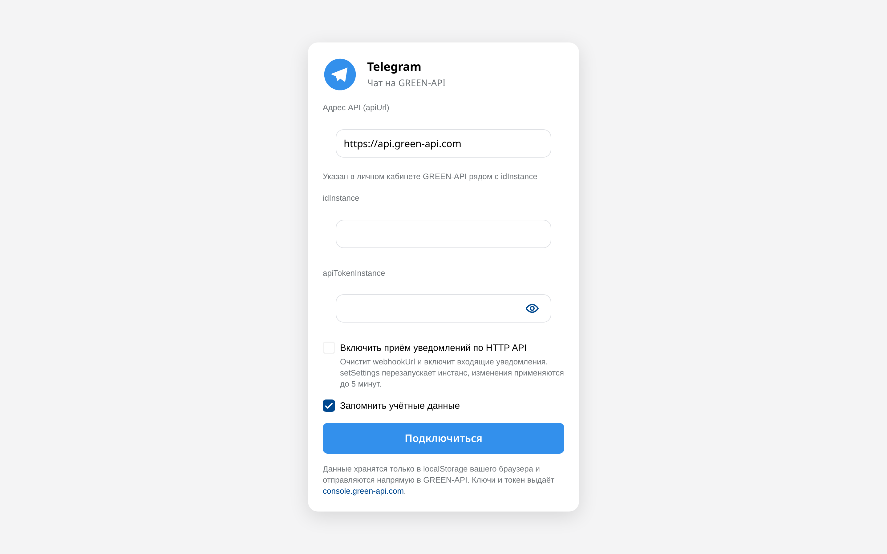
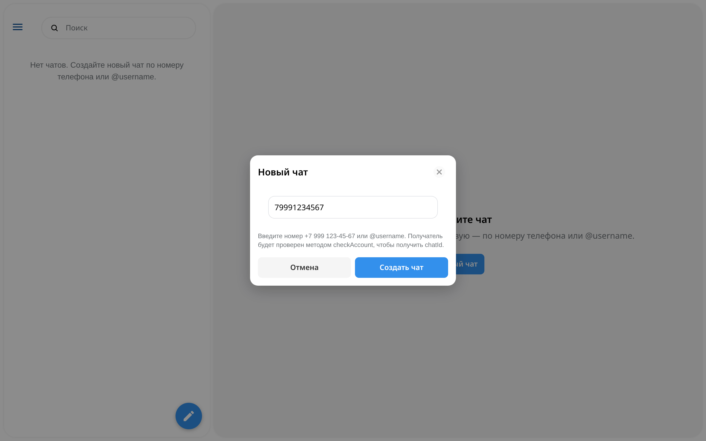
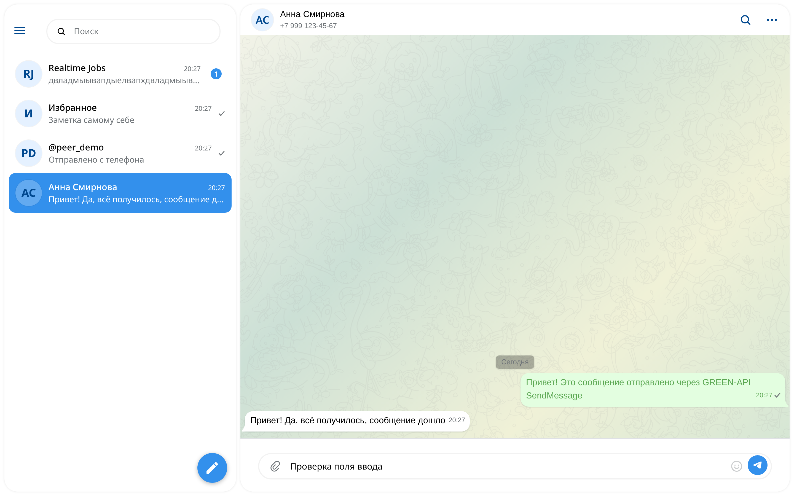
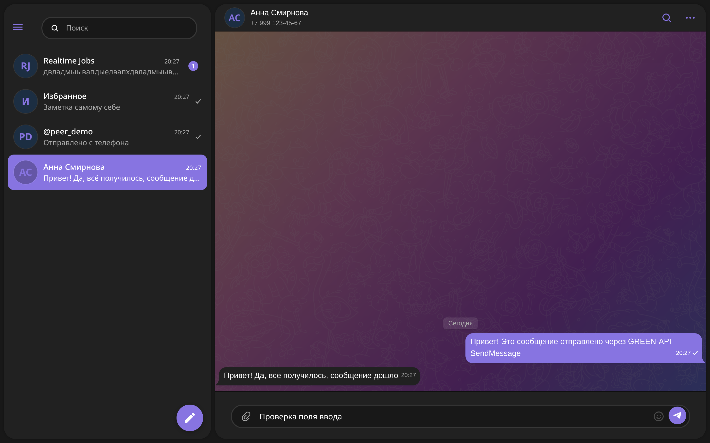

# Telegram-чат на GREEN-API

> Это единственный клиент в репозитории. Он живёт в [`apps/telegram`](.) и
> запускается из корня репозитория: `npm install`, затем `npm run dev` (порт
> 5174). Общий обзор — в [README.md корня](../../README.md).

Веб-клиент чата для мессенджера **Telegram** на базе HTTP API
[GREEN-API](https://green-api.com/telegram): пользователь входит по `idInstance`
и `apiTokenInstance`, создаёт чат по номеру телефона или `@username`, отправляет
текст методом `SendMessage` и видит ответ собеседника, который приходит длинным
опросом `ReceiveNotification` / `DeleteNotification`. Интерфейс собран на
официальном UI Kit Telegram и повторяет облик
[Telegram Web](https://web.telegram.org/k/) — палитра, геометрия и обои взяты не
на глаз, а из темы настоящего веб-клиента (см. [docs/telegram](#оформление)).

Приложение намеренно разделено на слои: транспорт GREEN-API, разбор уведомлений
и состояние чатов живут отдельно от интерфейса, поэтому каждый слой тестируется
независимо.

## Быстрый старт

Нужен Node.js 22.12 или новее (проверено на Node 26; рекомендуется 24 LTS).

```bash
nvm use          # из корня репозитория
npm install
npm run dev:telegram
```

Vite выводит локальный адрес в консоли; в [vite.config.ts](vite.config.ts) задан
порт 5174, по умолчанию это `http://localhost:5174`.

```bash
npm run build      # tsc --noEmit && vite build
npm test           # Vitest, 131 тест
npm run typecheck
npm run screenshots  # при запущенном dev-сервере
```

## Как пользоваться

1. Получите `idInstance` и `apiTokenInstance` инстанса **Telegram** в личном
   кабинете [console.green-api.com](https://console.green-api.com) и
   авторизуйте его по QR-коду.
2. Войдите на форме: `apiUrl` (по умолчанию `https://api.green-api.com`),
   `idInstance`, `apiTokenInstance`. Приложение вызовет `GetStateInstance` и
   покажет состояние инстанса.
3. При желании включите чекбокс «Включить приём уведомлений по HTTP API» — он
   вызывает `SetSettings` с пустым `webhookUrl`. Учтите: метод перезапускает
   инстанс и применяется до 5 минут, поэтому по умолчанию выключен.
4. Нажмите «Новый чат», введите `+7 999 123-45-67` или `@username`.
   `CheckAccount` вернёт `chatId`, по которому и пойдёт переписка.
5. Пишите текст, Enter или синяя кнопка — отправка. Ответ в Telegram придёт в
   чат сам: цикл опроса забирает уведомление и подтверждает его.

Учётные данные хранятся в `localStorage` под ключом
`green-api-telegram-chat:credentials` и отправляются из браузера напрямую в
GREEN-API (CORS разрешающий).

## Оформление

Цвет, размеры и радиусы взяты из темы настоящего веб-клиента Telegram: палитра
`day`/`night` лежит литералами в `themeController` сборки
<https://web.telegram.org/k/>, а геометрия пузырей и списка чатов — в его
таблицах стилей. Что именно воспроизводится и чем это подтверждено:

| Что | Значение | Источник |
| --- | --- | --- |
| Акцент, выбранный чат, бейдж | `#3390ec` / `#8774e1` | `themeController`, темы `day` / `night` |
| Поверхности | `#ffffff` / `#212121`, фон страницы `#ffffff` / `#181818` | там же |
| Вторичный текст | `#707579` / `#aaaaaa`, границы `#dfe1e5` / `#0f0f0f` | там же |
| Пузырь входящий | `#ffffff` / `#212121` | там же |
| Пузырь исходящий | `#e3fee0` (текст `#5ca853`) / `#8774e1` | там же |
| Пузырь | радиус 15 px, «хвостовой» угол 5 px, `min-width: 56px`, `max-width: min(30rem, 85%)`, тень `0 1px 2px rgba(16,35,47,.15)` | `index-*.css`, `.bubble` |
| Хвост пузыря | SVG 11×20 с путём `M-6 16h6v17…` в матрице `matrix(1 0 0 -1 0 49)`, зеркалится для входящих | `<symbol id="message-tail-filled">` |
| Текст сообщения | 16 px, `line-height: 1.3125`, время 12 px | `--messages-text-size` |
| Окно | отступ страницы 8 px, радиус колонок 24 px, мягкая тень | `--page-chats-padding`, `--main-column-border-radius`, `--column-box-shadow` |
| Обои | четырёхточечный градиент темы + монохромный SVG-паттерн Telegram в два слоя (760 px и 545 px, высота `auto`), opacity 0.13 в тёмной теме с `invert(1)` / 0.12 в светлой | паттерн — переиздание [TWallpaper](https://twallpaper.js.org/patterns/animals.svg) фирменной графики Telegram; градиент — `state-*.js`, тема `pattern` |
| Иконки | `src/assets/icons.woff2` (~55 КБ, сторонний ассет): Fontello-шрифт `icons`, 412 глифов в диапазоне U+F101–U+F29C; `.icon` и модификаторы `.icon--attach` F125 (скрепка), `.icon--compose` F1CD (карандаш), `.icon--send` F1CE (самолётик), `.icon--mic` F1C3 (микрофон) | «Generated by svg2ttf from Fontello project», <http://fontello.com/>; глифов в диапазоне U+E9xx нет, поэтому коды Telegram (E922, E955, E93F, E90B) пусты — шрифт нужно заменить своим или лицензировать перед публичным релизом |

Из библиотеки взяты `AppRoot`, `Cell`, `Avatar`, `Badge`, `Button`, `IconButton`,
`Input`, `Placeholder`, `Spinner`, типографика (`Text` и `Headline`) и иконки
(`dist/icons/<size>/<name>`). Собственными остаются только вещи, которых в
библиотеке нет: сетка из двух колонок, стена чата, пузыри с хвостами, галочки
доставки, композер, баннеры и оболочка диалога. Скрепка, карандаш, самолётик и
микрофон библиотека не рисует: в интерфейсе это глифы утилиты `.icon` из
шрифта [src/assets/icons.woff2](src/assets/icons.woff2) (коды ниже, в дереве
файлов и в [docs/telegram/design-telegram-web.md](docs/telegram/design-telegram-web.md)).

Строка списка чатов — флекс-линия, и сжиматься в ней должна только колонка
текста. Кит `Cell` кладёт слоты `before`/`after` в такие же гибкие обёртки, а
заголовок, время и превью — в два ряда `h6`, где флекс-элементами служат не наши
спаны, а обёртки-спаны самого кита; поэтому правила для заголовка, времени и
превью нацелены на `h6 > span`. Обёртки аватара и галочек доставки/бейджа при
этом обязаны сохранять собственную ширину: без этого одно длинное неразрывное
превью (например, повторяющийся текст без пробелов) переполняло линию и флексбокс
забирал место у 48-пиксельного аватара вместо текста — аватар схлопывался до
~10 px, а блок превью, начинающийся от левого края колонки контента, накрывал его
собой. Закрепляем их через `:has()`, а не через хешированные имена классов кита,
чтобы правило переживало обновления библиотеки:

```css
.sidebar .chat-row > :has(.chat-row__avatar),
.sidebar .chat-row > :has(.chat-row__ticks),
.sidebar .chat-row > :has(.chat-row__badge) { flex: none; }
```

Вложенное правило отдельно фиксирует и сам `.chat-row__avatar`.

Честные отличия от оригинала:

- **Иконки** — это глифы стороннего шрифта Fontello `icons` из
  [src/assets/icons.woff2](src/assets/icons.woff2), а не свободно
  лицензированный ассет. Утилита `.icon` задаёт семейство, а модификаторы —
  `content`: `.icon--attach` F125 (скрепка), `.icon--compose` F1CD (карандаш),
  `.icon--send` F1CE (самолётик), `.icon--mic` F1C3 (микрофон). Это не
  Telegram-шрифт `tgico`: глифов в диапазоне U+E9xx в нём нет, поэтому
  широко разошедшиеся коды Telegram (U+E922 скрепка, U+E955 карандаш, U+E93F
  отправка, U+E90B микрофон) дают пустоту — подставлять нужно проверенные коды
  выше, а F1CF — это шеврон, а не самолётик. Оговорка та же, что у паттерна:
  ассет сторонний, поэтому перед публичным релизом шрифт нужно заменить
  собственными иконками (или лицензировать).
- **Обои** — мы используем фирменный doodle-паттерн Telegram: монохромный SVG
  1440×2960 с чёрными обводками на прозрачном фоне, взятый из переиздания
  [TWallpaper](https://twallpaper.js.org/patterns/animals.svg), который
  распространяет паттерны, извлечённые из официального клиента. Именно поэтому
  по фону мы на визуальном паритете с оригиналом: градиент темы плюс паттерн
  двумя слоями. Оговорка здесь одна — лицензионная: это графика Telegram, а не
  свободно лицензированный ассет, поэтому её место в обсуждении лицензии и
  атрибуции проекта, а перед публичным релизом паттерн нужно заменить
  собственной плиткой (или лицензировать).
- **Диалог «Новый чат»** — центрированная карточка, как в Telegram Web, а не
  bottom sheet из китового `Modal`: китовый `Modal` позиционируется трансформом
  vaul, который нельзя переопределить из таблицы стилей, не сломав анимацию.
  Оболочка диалога своя, всё внутри — китовые компоненты.
- **Тёмная тема** следует системной настройке `prefers-color-scheme`; отдельного
  переключателя нет — для прототипа это лишняя функция.

Подробности — в [docs/telegram/design-telegram-web.md](docs/telegram/design-telegram-web.md),
[docs/telegram/telegram-web-palette.md](docs/telegram/telegram-web-palette.md) и
[docs/telegram/telegram-ui-reference.md](docs/telegram/telegram-ui-reference.md).

## Архитектура

```text
src/
├── main.tsx                     точка входа: монтирует <App /> в #root
├── App.tsx                      контейнер: сессия, состояние инстанса, polling, отправка и создание чата
├── api/
│   ├── greenApi.ts              типизированный клиент GREEN-API, маппинг ошибок, resolveChatByContact
│   ├── phone.ts                 нормализация номера и @username, форматирование, legacy chatId `phone@c.us`
│   └── types.ts                 DTO методов и уведомлений по документации
├── hooks/
│   └── useNotificationPolling.ts  цикл receiveNotification → обработка → deleteNotification с backoff
├── store/
│   ├── chatStore.ts             чистый редьюсер чатов, жизненный цикл сообщений, селекторы
│   └── credentials.ts           чтение/запись idInstance, apiTokenInstance, apiUrl в localStorage
├── components/
│   ├── LoginScreen.tsx          форма входа: apiUrl, idInstance, токен, переключатели
│   ├── Sidebar.tsx              бургер с меню аккаунта, логотип, поле поиска, список чатов на Cell, плавающая кнопка нового чата
│   ├── ChatHeader.tsx           заголовок чата: аватар, имя, телефон, поиск по чату и панель сведений
│   ├── MessageList.tsx          лента: группировка по дням и «пачкам», плашки дат, автопрокрутка
│   ├── MessageBubble.tsx        пузырь, хвост, время и галочки статуса
│   ├── MessageComposer.tsx      композер: поле-пилюля, скрепка во внутреннем слоте before, эмодзи и кнопка отправки в after
│   ├── NewChatDialog.tsx        центрированный диалог создания чата по номеру или @username
│   ├── ChatPlaceholder.tsx      заглушка, когда чат не выбран
│   ├── icons.tsx                рукописные SVG вне шрифта иконок (поиск, меню, «ещё», эмодзи, выход, логотип, глаз, предупреждение, галочки); IconSend и IconCompose остались, но больше не используются
│   └── Splash.tsx               экран подключения при старте
├── assets/
│   ├── icons.woff2              иконочный шрифт Fontello `icons` (~55 КБ, сторонний ассет), 412 глифов U+F101–U+F29C; скрепка F125, карандаш F1CD, самолётик F1CE, микрофон F1C3, кодов U+E9xx нет
│   └── telegram-pattern.svg     паттерн-обои Telegram: монохромный doodle-SVG (~222 КБ), сторонний ассет
├── styles/
│   └── app.css                  слой мессенджера поверх токенов @telegram-apps/telegram-ui
└── test/
    ├── setup.ts                 jest-dom и заглушка matchMedia для jsdom
    └── response.ts              минимальная заглушка Response для тестов клиента
```

Состояние — `useReducer` с чистым редьюсером ([src/store/chatStore.ts](src/store/chatStore.ts)),
побочные эффекты — в хуке ([src/hooks/useNotificationPolling.ts](src/hooks/useNotificationPolling.ts)).
Разбор уведомлений отделён от редьюсера: `extractText` и разбор `senderData`
живут в [src/store/chatStore.ts](src/store/chatStore.ts), транспорт — в
[src/api](src/api).

### Почему React 18

`@telegram-apps/telegram-ui` объявляет `react@^18.2.0`, поэтому приложение — на
React 18. Другой версии React в рабочей области нет: npm поднимает React 18.3.1
в корень, и базовые спецификаторы `react` / `react-dom` резолвятся в эту
единственную копию, поэтому алиасы на локальную копию в
[vite.config.ts](vite.config.ts) больше не нужны и удалены. Остался один алиас —
`@testing-library/react` на его ESM-сборку: Vitest резолвит по правилам Node и
иначе загрузил бы Testing Library как CJS и притащил в тестовый процесс второй
React («Invalid hook call»).

## Как работает получение сообщений

Используется документированный двухшаговый цикл HTTP API:

1. `receiveNotification` — длинный опрос с `receiveTimeout = 10` секунд (клиент
   зажимает значение в диапазон 5–60 секунд).
2. Тело уведомления (`typeWebhook`, `senderData`, `messageData`) передаётся в
   редьюсер действием `notification/received`.
3. Только после обработки вызывается `deleteNotification` с `receiptId`: без
   него то же уведомление выдаётся повторно, а очередь FIFO не двигается. Вызов
   стоит в `finally`, поэтому уведомление подтверждается даже при ошибке.
4. Пустой ответ означает «сообщений нет»; цикл ждёт секунду и опрашивает снова.

Очередь хранится 24 часа и выдаётся по порядку. При повторяющихся ошибках цикл
не останавливается: баннер показывает ошибку, а пауза растёт экспоненциально от
2 до 30 секунд. Ошибки 4xx (кроме 429 и «самолечащегося» 400 прочитанного
`webhookUrl` после `SetSettings`) означают неверную конфигурацию — цикл
останавливается, в интерфейсе появляется кнопка «Повторить».

## Как определяется chatId

Получатель задаётся номером телефона **или** `@username`
([parseRecipient](src/api/phone.ts)), после чего `checkAccount`
([resolveChatByContact](src/api/greenApi.ts)) возвращает числовой `chatId`, по
которому идёт отправка. Это рекомендованный документацией путь: сообщение,
отправленное на legacy-форму `phone@c.us`, тарифом считается другим чатом и
ненадёжно связывается со входящими ответами.

Если проверка не прошла (rate limit 469, недоступен мессенджер, инстанс
перезапускается), приложение не блокирует пользователя: оно отправляет на
`phone@c.us` или `@username` и честно предупреждает, что ответ может не
связаться с этим чатом. Отдельное уведомление появляется, когда Telegram ответил,
что аккаунта на номере нет.

## Как определяется собеседник

Уведомления двух видов описывают `senderData` **по-разному**, и это единственное,
что нельзя вывести из документации — оно вскрылось на живом инстансе.

- **Входящее** (`incomingMessageReceived`): в `senderData` лежит собеседник —
  `chatId`, имя и телефон.
- **Исходящее** (`outgoingMessageReceived`, `outgoingAPIMessageReceived`):
  в `senderData` лежит **сам аккаунт**. Реальный пример с инстанса:

  ```json
  "senderData": {
    "chatId": "6900000001",        ← собеседник
    "sender": "305000000",         ← чат «Избранное», то есть мы
    "chatName": ".",               ← профиль собеседника без имени
    "senderName": "Владелец",        ← мы
    "senderPhoneNumber": 79001234567  ← наш номер
  }
  ```

  Собственник — только `chatId`. Взять отсюда имя или телефон нельзя: чат
  получает имя владельца аккаунта, а `senderPhoneNumber` совпадает с номером
  самого аккаунта, из-за чего уведомления разных чатов находят друг друга по
  телефону. `sender === chatId` означает сообщение самому себе — такой чат
  называется «Избранное».

Имя собеседника в исходящем уведомлении отсутствует (у пользователя без имени
display name приходит как «.»), поэтому на такой чат приложение отвечает одним
вызовом `getContactInfo` и подставляет `@username` или телефон. Один вызов на
чат; если он не удался, чат остаётся с честным «Чат <id>», а сообщение всё
равно показано.

## Дедупликация и статусы

Исходящее сообщение добавляется оптимистично с временным id
`local:<время>:<суффикс>` и статусом `sending`. После ответа `SendMessage` действие
`message/sent` заменяет его на серверный `idMessage` и переводит в `sent`; при
ошибке `message/failed` сохраняет текст ошибки под пузырём.

Входящие уведомления дедуплицируются по `idMessage`. У Telegram этот
идентификатор уникален **в пределах чата**, поэтому статус доставки ищется
только внутри чата, названного самим уведомлением, — идентификаторы из разных
чатов не смешиваются. Отдельно обработана гонка, когда `outgoingAPIMessageReceived`
приходит раньше ответа `SendMessage`: тогда `message/sent` удаляет локальную
копию, а не дублирует её.

В пузыре видно: `sending` и `sent` — одна галочка, `delivered` — две серые,
`read` — две синие, `failed` и `noAccount` — красный маркер с причиной из
`description`. По документации уведомления `failed` и `noAccount` отключить нельзя,
поэтому они обрабатываются в обязательном порядке.

## Тесты

131 тест в 8 файлах (Vitest, jsdom, настройки в [vite.config.ts](vite.config.ts)
и [src/test/setup.ts](src/test/setup.ts)):

- [src/api/phone.test.ts](src/api/phone.test.ts) — `normalizePhone`, `formatPhone`, `normalizeUsername`, `parseRecipient`.
- [src/api/greenApi.test.ts](src/api/greenApi.test.ts) — эндпоинты, тело запроса, `receiveTimeout`, разбор ошибок, `resolveChatByContact`.
- [src/store/chatStore.test.ts](src/store/chatStore.test.ts) — извлечение текста, создание чатов, дедупликация, оптимистичная отправка, статусы в пределах чата, селекторы, сентинел `senderPhoneNumber: 0`.
- [src/store/credentials.test.ts](src/store/credentials.test.ts) — чтение, запись, битый JSON и значения по умолчанию.
- [src/hooks/useNotificationPolling.test.ts](src/hooks/useNotificationPolling.test.ts) — порядок «получить → обработать → подтвердить», остановка на 4xx, повторные попытки, `deleteNotification` с `result: false`.
- [src/App.test.tsx](src/App.test.tsx) — интеграционный сценарий под `StrictMode`: вход, создание чата, отправка, приход уведомления, восстановление сессии, отказ при неверных данных, баннер опроса без открытого чата, вход по `@username`, ошибка отправки под пузырём, подпись аккаунта в бургер-меню и откат к `idInstance`, когда `getAccountSettings` недоступен, выход из меню, поиск по открытому чату, пустой результат поиска и отмена поиска.
- [src/components/avatar.test.ts](src/components/avatar.test.ts) — инициалы аватара: `@peer_demo` → CT, номер телефона → первые цифры.
- [src/test/telegramui-smoke.test.tsx](src/test/telegramui-smoke.test.tsx) — китовые компоненты рендерятся внутри `AppRoot`.
- [src/store/chatStore.test.ts](src/store/chatStore.test.ts) — отдельный блок регрессий на **живых** уведомлениях с реального инстанса.

## Скриншоты

| Вход | Диалог создания чата |
| --- | --- |
|  |  |

| Переписка | Переписка в тёмной теме |
| --- | --- |
|  |  |

Снимки воспроизводятся командой `npm run screenshots` при запущенном
`npm run dev:telegram`: скрипт [scripts/screenshots.mjs](scripts/screenshots.mjs)
поднимает headless Chromium по протоколу Chrome DevTools (без дополнительных
зависимостей), подменяет `fetch` на фикстуры GREEN-API и проверяет, что исходящее
и входящее сообщения действительно отрисованы, а на снимке `03-conversation`
в поле ввода набран текст и кнопка отправки поэтому активна. В набор сценариев
входит и чат, последнее сообщение которого — одна длинная неразрывная строка
без пробелов: именно на ней превью обязано обрезаться многоточием, а не
разъезжаться по строке. Готовность приложения скрипт не угадывает фиксированной
паузой, а опрашивает страницу
(`waitFor`), пока не смонтируется сайдбар или экран входа: холодная
трансформация Vite с 222 КБ паттерна и 55 КБ шрифта в бандле длится дольше любой
константы. Если приложение так и не поднялось, скрипт не падает молча: он
собирает `Runtime.exceptionThrown` и `console.error` страницы и в тексте ошибки
печатает URL, первые символы `document.body.innerText` и накопленные ошибки —
сбой называет свою причину сам. Если Vite слушает
не тот адрес, адрес страницы передаётся переменной окружения:
`APP_URL=http://localhost:5174/ npm run screenshots`.

## Что проверено, а что нет

Проверено в этом репозитории:

- `npm run typecheck` — без ошибок (строгий `tsconfig`, включая тесты).
- `npm test` — 131 тест в 8 файлах, все проходят.
- `npm run build` — production-сборка приложения собирается; на CSS- и
  JS-бандлы новые ассеты не влияют, но в вывод сборки добавлены сами ассеты:
  SVG-паттерн на 222 КБ и иконочный шрифт `icons.woff2` на 55 КБ.
- `npm run screenshots` — интерфейс реально отрисовывается в headless Chromium,
  включая приход входящего сообщения через опрос очереди; отдельная проверка
  ловит, что ушло ровно одно `SendMessage` с документальным телом
  `{"chatId":"…","message":"…"}`, а имя собеседника в списке чатов не подменяется
  именем владельца аккаунта.
- **Сторож разметки** в том же прогоне измеряет худшую строку списка чатов прямо
  в браузере: у чата с длинным неразрывным превью он падает, если превью
  перенеслось на вторую строку, подошло ближе 8 px к левому краю строки или
  наложилось на аватар. Порог заведомо мягче исправленной геометрии (после
  починки превью стоит в 72 px от левого края строки в одну строку), и всё же
  ловит прежнее поведение, когда превью уезжало к краю панели и тащило за собой
  аватар. В юнит-тестах такую регрессию поймать нельзя: они
  идут в jsdom, где нет движка раскладки и `getBoundingClientRect` не отражает
  реальную геометрию, поэтому проверка живёт в браузерном сценарии
  [scripts/screenshots.mjs](scripts/screenshots.mjs).

**Живая проверка на настоящем инстансе GREEN-API (Telegram, кластер 4100).**
Учётные данные в репозиторий не попадают; проверка шла через переменные окружения.

| Шаг | Результат |
| --- | --- |
| `GetStateInstance` | `authorized` (до этого инстанс был `notAuthorized`; авторизация выполнена по QR из метода `QR`) |
| `GetAccountSettings` | телефон, `@username`, `chatId` чата «Избранное» — подпись аккаунта в шапке работает |
| `SendMessage` | `{"idMessage":"1790683577915"}` — отправка проходит |
| `ReceiveNotification` | длинный опрос отдаёт настоящие `incomingMessageReceived` и `outgoingAPIMessageReceived` |
| `DeleteNotification` | `{"result":true,"reason":""}` — очередь сдвигается |
| `GetContactInfo` | вернул `@peer_demo` и `+7 903 145-52-17` для чата, который пришёл только как `chatId` |
| Приложение целиком | подключилось к живому инстансу, приняло уведомление и показало чат `@peer_demo` с инициалами `CT` |

Живой прогон вскрыл то, чего нет в документации: в исходящих уведомлениях
`senderData` описывает отправителя, а не собеседника (см. [Как определяется
собеседник](#как-определяется-собеседник)). Оба реальных payload закреплены
регрессионными тестами в [src/store/chatStore.test.ts](src/store/chatStore.test.ts).

Не проверено: входящие сообщения от собеседника проверялись по уведомлению,
которое отправлено через API; собеседник не отвечал из своего клиента Telegram.
История чата не подгружается (`getChatHistory` в приложении не используется) —
при перезагрузке страницы остаются только те чаты, чьи уведомления пришли
заново.

## Ограничения и замечания по безопасности

- Обрабатываются только текстовые сообщения: файлы, изображения, стикеры и прочие
  типы игнорируются, `extractText` для них возвращает `null`.
- Токен хранится в `localStorage` и уходит из браузера прямо в GREEN-API. Для
  демо это приемлемо, в продакшене токен должен жить на бэкенде.
- `idInstance` и `apiTokenInstance` — секрет: не публикуйте их и не коммитьте
  заполненный `.env`-подобный файл.
- Отправка блокируется в состояниях `notAuthorized`, `blocked` и
  `pendingPassword`; в состоянии `suspended` Telegram разрешает писать только
  сохранённым контактам, поэтому приложение показывает предупреждение, но не
  блокирует композер.
- `SetSettings` перезапускает инстанс и применяется до 5 минут, поэтому включение
  приёма по HTTP API вынесено в отдельный чекбокс и по умолчанию выключено.
- При частых проверках `checkAccount` Telegram может ограничить проверку контактов
  (HTTP 469): приложение показывает это как ошибку и предлагает повторить позже.

## Использованные методы API

Все запросы строятся как `{{apiUrl}}/waInstance{{idInstance}}/<method>/{{apiTokenInstance}}`
— префикс `/waInstance` у Telegram-продукта остался историческим, отдельного
пути `/telegram` нет (в коде — `GreenApiClient.endpoint`).

| Метод | HTTP | Путь | Роль в приложении |
| --- | --- | --- | --- |
| `SendMessage` | POST | `/sendMessage/{{apiTokenInstance}}` | Отправка текста (до 4096 символов); ответ `idMessage` заменяет локальный идентификатор. |
| `ReceiveNotification` | GET | `/receiveNotification/{{apiTokenInstance}}?receiveTimeout=<5..60>` | Длинный опрос очереди уведомлений; пустой ответ означает «сообщений нет». |
| `DeleteNotification` | DELETE | `/deleteNotification/{{apiTokenInstance}}/{{receiptId}}` | Подтверждение уведомления, чтобы очередь FIFO сдвинулась. |
| `GetStateInstance` | GET | `/getStateInstance/{{apiTokenInstance}}` | Проверка учётных данных и состояния инстанса при входе и восстановлении сессии. |
| `SetSettings` | POST | `/setSettings/{{apiTokenInstance}}` | Очистка `webhookUrl` и включение входящих/исходящих уведомлений для HTTP API. |
| `CheckAccount` | POST | `/checkAccount/{{apiTokenInstance}}` | Поиск получателя по номеру или `@username` и получение `chatId`. |
| `GetAccountSettings` | GET | `/getAccountSettings/{{apiTokenInstance}}` | Подпись аккаунта (`@username` или телефон) в шапке, как в Telegram Web; ошибка не блокирует вход. |
| `GetContactInfo` | POST | `/getContactInfo/{{apiTokenInstance}}` | Имя и телефон собеседника, найденного через уведомление (см. [Как определяется собеседник](#как-определяется-собеседник)). |

## Источники

- GREEN-API для Telegram: <https://green-api.com/telegram>
- Документация API Telegram: <https://green-api.com/telegram/docs/api/>
- Контракты методов: [docs/telegram/contracts-sending.md](docs/telegram/contracts-sending.md), [contracts-receiving.md](docs/telegram/contracts-receiving.md), [contracts-account-service.md](docs/telegram/contracts-account-service.md)
- Живая проверка на инстансе и реальные payload уведомлений: [docs/telegram/live-verification.md](docs/telegram/live-verification.md)
- Официальный UI Kit: [@telegram-apps/telegram-ui](https://www.npmjs.com/package/@telegram-apps/telegram-ui), референс по API 2.1.13 — [docs/telegram/telegram-ui-reference.md](docs/telegram/telegram-ui-reference.md)
- Оформление Telegram Web: [docs/telegram/telegram-web-palette.md](docs/telegram/telegram-web-palette.md), [docs/telegram/design-telegram-web.md](docs/telegram/design-telegram-web.md)
